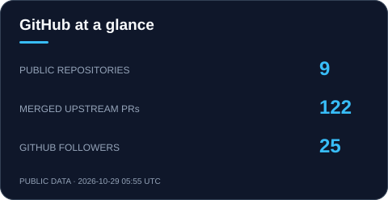
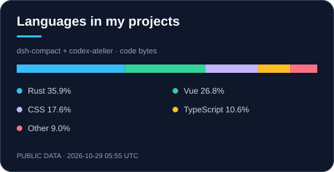

# 你好，我是 Zixin 👋

**AI Agent 与 LLM 开发者 · 上下文工程 · 开源贡献**

围绕 Agent Runtime、上下文压缩与模型集成，构建更实用的开发工具。 
把想法做成工具，也把修复带回上游。

  
  
  

[代表项目](#projects) · [开源贡献](#contributions) · [技术与工程](#stack) · [开发足迹](#activity)

---

## ⚡ 关于我

- **开发与贡献：** AI Agents、Context Engineering、Tool Use、模型 Provider 与 AI Tooling。
- **上下文工程：** 在 `dsh-compact` 中实现自动与手动压缩、工具结果裁剪和有界溢出恢复。
- **桌面工具：** 在 `Codex Atelier` 中探索 Tauri 2 + Vue 3 的开发工作台与环境管理交互。
- **学习与探索：** RAG、Agentic RAG、Agent Memory、MCP 与 LLM 应用评估。

---

## 🚀 代表项目

<table>
  <tr>
    <td width="50%" valign="top">
      <h3 align="center">🧩 <a href="https://github.com/Ebony-Vinyl/dsh-our-free-model">Our Free Model / OFM</a></h3>
      
<b>连接模型渠道与开发工具</b> 主要维护者

      

        
        
        
      

      <ul>
        <li><b>模型接入：</b>为 DeepSeek Harness 整合多种模型渠道、账号与 Provider。</li>
        <li><b>本地网关：</b>提供 OpenAI 兼容接口，连接其它开发工具与客户端。</li>
        <li><b>使用体验：</b>包含模型管理、用量看板、运行日志与应用内升级。</li>
        <li><b>维护工作：</b>账号渠道的排队换号、请求级重试保护与相关修复。</li>
      </ul>
      
<a href="https://github.com/Ebony-Vinyl/dsh-our-free-model#readme"><b>查看项目 →</b></a> · <a href="https://github.com/Ebony-Vinyl/dsh-our-free-model/pulls?q=is%3Apr+is%3Amerged+author%3Azixin947"><b>我的贡献 →</b></a>

    </td>
    <td width="50%" valign="top">
      <h3 align="center">🖥️ <a href="https://github.com/zixin947/codex-atelier">Codex Atelier</a></h3>
      
<b>为开发工作流留一间工作室</b>

      

        
        
        
      

      <ul>
        <li><b>桌面原型：</b>使用 Tauri 2、Vue 3 与 TypeScript 构建独立伴侣工作站。</li>
        <li><b>工作台交互：</b>探索环境概览、扩展管理、诊断与回退的界面组织。</li>
        <li><b>视觉设计：</b>米灰机壳、下沉仪表屏与薄荷绿键帽，营造有触感的工作空间。</li>
        <li><b>当前进度：</b>行为插件管理已接入本机能力；主工作台等模块仍使用演示数据。</li>
      </ul>
      
<a href="https://github.com/zixin947/codex-atelier#preview"><b>查看界面与功能进度 →</b></a>

    </td>
  </tr>
</table>

---

## 🌐 开源贡献

参与 DeepSeek Harness 生态的插件、桌面客户端与模型集成开发，通过修复、文档和回归验证向上游贡献。

| 上游项目 | 项目方向 | 我的贡献记录 |
| :--- | :--- | :--- |
| [dsh-TUI](https://github.com/ccch1mneyyy/dsh-TUI) | 终端界面与 Agent 会话工具 | [查看已合并 PR](https://github.com/ccch1mneyyy/dsh-TUI/pulls?q=is%3Apr+is%3Amerged+author%3Azixin947) |
| [EAC Desktop](https://github.com/Ebony-Vinyl/EAC-Desktop) | DeepSeek Harness 插件整合与桌面客户端 | [查看已合并 PR](https://github.com/Ebony-Vinyl/EAC-Desktop/pulls?q=is%3Apr+is%3Amerged+author%3Azixin947) |
| [Our Free Model / OFM](https://github.com/Ebony-Vinyl/dsh-our-free-model) | 模型 Provider 与 LLM 工具 | [查看已合并 PR](https://github.com/Ebony-Vinyl/dsh-our-free-model/pulls?q=is%3Apr+is%3Amerged+author%3Azixin947) |

  
  

---

## 🛠️ 技术与工程

| 方向 | 技术与实践 |
| :--- | :--- |
| **AI / LLM** | DeepSeek Harness、Agent 插件、上下文压缩、模型 Provider、工具调用 |
| **应用与工具** | JavaScript、TypeScript、Node.js、HTTP / SSE、Vue 3、Electron |
| **全栈基础** | Java、Spring Boot、MySQL |
| **工程实践** | Git、GitHub Actions、回归测试、插件集成 |
| **正在探索** | RAG、Agent Memory、MCP、LLM 应用评估 |

  

---

## 📊 开发足迹

  
  

卡片每 6 小时更新一次；语言分布仅统计 dsh-compact 与 codex-atelier，按 GitHub 返回的代码字节数计算。

### 🐍 贡献轨迹

<picture>
  <source media="(prefers-color-scheme: dark)" srcset="assets/github-contribution-snake-dark.svg" />
  <source media="(prefers-color-scheme: light)" srcset="assets/github-contribution-snake.svg" />
  
</picture>

---

## 🤝 交流与协作

欢迎围绕 **Agent 工具、上下文工程、模型集成与桌面交互**交流想法。

- [dsh-compact Issues](https://github.com/zixin947/dsh-compact/issues)：插件使用、兼容性与问题反馈。
- [Codex Atelier Issues](https://github.com/zixin947/codex-atelier/issues)：界面建议、原型体验与功能讨论。

**让工具更顺手，让想法走得更远。**

